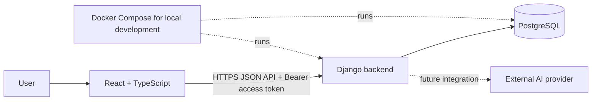

# System Architecture

> Status: Proposed baseline
> Updated: 2026-10-14

## Goals

Build a small recipe and shopping-list web application that is understandable, modular, and practical to extend. Keep one deployable backend and one frontend; do not introduce microservices or abstractions without a concrete need.

## System Context



The browser is untrusted. Django owns authentication, authorization, validation, and persistence. External services, including AI providers, are called only by the backend. PostgreSQL is the recommended target database. Docker Compose is the recommended way to run PostgreSQL locally, but Docker is not a technical requirement; PostgreSQL can also be installed directly or provided by a managed service.

## Backend: Django Modular Monolith

Organize Django code by product domain, with separate Django apps as the codebase grows:

```text
backend/
  config/                 # Django settings, root URLs, ASGI/WSGI
  accounts/               # users, JWT issuance, refresh, and revocation
  recipes/                # recipes, ingredients, and recipe operations
  shopping_lists/         # groups, list items, and shopping-list operations
```

The listed apps are a target boundary, not a requirement to create empty apps before they are needed. A Django app owns its domain models and behavior. Cross-app dependencies should be explicit and point toward stable interfaces; avoid circular imports. Keep HTTP views focused on translating requests and responses. Put domain operations in the owning app, extracting a service only when a workflow has enough logic to make that separation useful. Use Django's built-in ORM and migrations rather than creating a second persistence abstraction without a demonstrated need.

The frontend communicates with Django through a JSON API. Django REST Framework is the recommended API implementation, but it has not yet been selected.

### Authentication: JWT

- Login and registration return a short-lived access JWT in the response body. React keeps it in memory and sends it as `Authorization: Bearer <token>`; do not persist access or refresh tokens in `localStorage` or `sessionStorage`.
- The backend sets a rotating refresh JWT in an `HttpOnly`, `Secure` (in production), `SameSite=Lax` cookie. The frontend cannot read the cookie. The refresh endpoint validates it and issues a new access token and rotated refresh token.
- Use short configurable lifetimes (initial proposal: 10 minutes for access and 7 days for refresh). Refresh tokens are single-use; persist only the token identifier/revocation state needed to detect reuse and support logout, not raw bearer credentials where avoidable.
- Logout revokes the current refresh token/token family and clears the cookie. Already-issued access tokens may remain usable until their short expiry; immediate revocation of every access token is not required for the prototype.
- Because browsers attach the refresh cookie automatically, protect refresh/logout cookie endpoints with CSRF defenses and strict origin checks. Bearer-token API requests are not authenticated from ambient cookies. Allow only the configured frontend origin; use HTTPS in production.
- Prefer a same-origin development proxy for the React app and API to reduce CORS and cookie configuration complexity. If separate origins are used, configure credentialed refresh requests, explicit CORS origins, CSRF trusted origins, and cookie attributes together.

The signing key must come from environment/secret configuration, not source control or the database. JWTs should have an explicit issuer, audience, token type, and expiration. The backend derives the user identity from a validated token and checks resource ownership on every request. Exact API routes and the JWT library remain implementation decisions.

### Persistence and Local Development

Use Django ORM models and migrations with PostgreSQL as the recommended relational database. For local development, Docker Compose can run a pinned PostgreSQL image with a named volume; application secrets and database credentials belong in local environment configuration and must not be committed. Docker is optional: a developer may run PostgreSQL directly. A managed PostgreSQL service can be used outside local development. SQLite remains a simpler prototype alternative but is not the proposed target for multi-user use.

## Frontend: Component-Based Architecture

Organize the React application by both responsibility and product feature. Shared components contain reusable, domain-neutral UI. Feature modules compose those components into recipe, account, and shopping-list workflows.

```text
frontend/src/
  app/                    # application setup, routes, global providers, page shell
  shared/
    ui/                   # reusable, domain-neutral components
    api/                  # shared HTTP client and transport-level types
    lib/                  # small, genuinely shared utilities
  features/
    accounts/             # authentication screens and account-specific UI
    recipes/              # recipe pages, forms, and feature components
    shopping-lists/       # list pages and feature components
```

This is the intended direction for the initial frontend, not a mandate to create every folder up front. A feature owns its screens, feature-specific components, and API operations. `shared/ui` must not depend on product features or make network requests. Features may compose shared UI; shared UI must not import feature code. Keep API calls behind a small shared transport boundary and feature-owned API functions rather than scattering `fetch` calls across visual components.

### Core UI Components

Build a small shared component set around repeated visual or interaction needs, for example `Button`, text inputs, `Checkbox`, `RadioGroup`, labels/form fields, and accessible dialog primitives. Prefer semantic HTML and composition. A generic `List` component should be introduced only if multiple uses genuinely share the same behavior and accessibility contract; recipe lists and shopping lists may need different feature-level components.

A shared component should have a clear purpose, typed props, keyboard and screen-reader behavior, and defined states (such as disabled, loading, selected, invalid, or empty when relevant). Domain rules and API behavior belong in feature modules, not in generic controls. Add a shared component when reuse is real or a consistent UI contract is valuable, not merely to wrap every HTML element.

## Component-Driven Development

CDD is the development workflow; Component-Based Architecture is the resulting composition structure. For a reusable or complex UI element:

1. Identify its user-facing responsibility, variants, states, and accessibility behavior.
2. Build and review it independently with representative content and state examples.
3. Verify behavior and keyboard interaction with a focused component test; add visual examples/stories when useful.
4. Compose it into feature components and screens, then verify the integrated user flow.
5. Promote feature-local UI into `shared/ui` only when its domain-neutral reuse and interface are clear.

A component catalog tool such as Storybook may help as the library grows, but it is not a prerequisite for the first components. The initial setup should use the project's chosen test tooling and avoid adding dependencies before there is a concrete benefit.

## Engineering Principles

Apply the principles pragmatically; they guide decisions rather than require a particular number of layers or classes.

- **SOLID:** give modules a clear reason to change; keep component props and API contracts focused; make implementations substitutable where a real interface exists; point feature code at stable boundaries rather than transport details when that reduces coupling.
- **DRY:** share stable behavior when duplication is real. Similar-looking code with different domain meaning does not automatically need one abstraction.
- **KISS:** prefer the simplest implementation that meets the current requirements. Avoid generic frameworks, premature service layers, and indirection without a concrete use case.
- **OOP:** use Django models and other framework-supported classes where they fit. In React, prefer function components and composition; OOP does not mean turning every UI element or operation into a class.

## Quality and Verification

- Test domain behavior in the owning Django app and API behavior at the request boundary.
- Test reusable UI behavior at the component boundary and important user workflows across composed features.
- Components and forms must be keyboard operable, use semantic labels, and expose state beyond color alone.
- Keep ownership checks on the backend; never trust a frontend-supplied owner ID.
- Add architecture or dependency changes to this document when they affect module boundaries. Record cross-cutting choices and alternatives in `docs/decisions/`.

## Open Decisions

- Django REST Framework or another Django API approach.
- Confirm PostgreSQL as the selected database and choose the Docker Compose image/version and local secret setup.
- Django REST Framework and the JWT library.
- Frontend routing, component test tooling, and whether/when to add Storybook.
- Same-origin development and deployment arrangement for refresh cookies, CSRF, and API requests.
